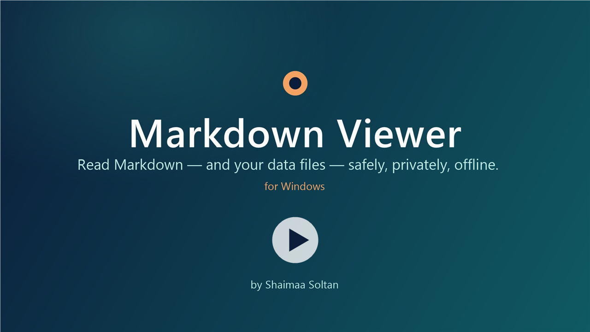

# ReadSafe Viewer

A Markdown and file viewer for Windows. Double-click a `.md` file and it opens in the app's own
window with figures, math, code colouring and diagrams. The viewer never runs code from a document.
It also shows CSV/TSV tables, JSON, Excel workbooks, XML, Jupyter notebooks, source code, config files
and logs as data and text, never run.

[](docs/promo.mp4)

▶ **[Watch the promo video](docs/promo.mp4)** (MP4, 1080p, 1:16, no sound)

## Features

- **Markdown rendering** with [marked](https://github.com/markedjs/marked), including tables, task lists and inline HTML (sanitised)
- **Math** with [KaTeX](https://katex.org) (`$…$`, `$$…$$`, ```` ```math ````)
- **Code colouring** with [highlight.js](https://highlightjs.org)
- **Diagrams** with [Mermaid](https://mermaid.js.org) (```` ```mermaid ````)
- **Folder sidebar** with every supported file next to the opened one and a type icon. **View File types**, beside **¶ Hidden**, opens checkboxes with counts to filter Markdown, tables, JSON, Excel, XML, notebooks, source code, HTML, config and text; choices are remembered. After a folder search, **☷ All files** and **🔎 Search results** choose which files this list shows.
- **Document menu**: Contents, Images, Links and Source appear when they apply. Only one document panel can be open at a time; the menu shows each panel's **On/Off** state. Contents and Source apply to Markdown; Images and Links appear when the document contains them.
- **Images list** (Document › Images, Ctrl+Shift+G): every picture in the document as a thumbnail; click to go to it, double-click to enlarge, and step through them in the viewer with ‹ › or the arrow keys
- **Links list** (Document › Links, Ctrl+Shift+L): every link with its text and real address (web, e-mail, other Markdown files, sections, disabled files); links flagged by the safety check are marked ⚠. Clicking an entry goes to the link in the document without opening it; ⧉ copies the address
- **Counts**: lines, characters, words, sentences, paragraphs, reading time, images, links, tables, code blocks, equations
- **Breakdown** that reconciles the source file with what is shown, and a **Characters** inspector (encoding, escapes, zero-width and hidden characters, leftover placeholders)
- **Safety check**: a ✓ Safe / ⚠ / ✗ Unsafe badge for every document, with a report of tricks aimed at you, at AI assistants or at other apps. It looks for scripts and active content, links whose text shows another address, look-alike addresses and letters, links to programs, network-share links, tracking pixels, hidden text and copy-paste traps, hidden instructions for AI tools, commands that download and run code, and Trojan Source text-direction tricks
- **Toolbar menus**: Open groups **Open Folder** and **Open Files**; Export groups clean source/text copy and save, Save as web page, and Save as PDF. Find sits beside **¶ Hidden**. **🎨 Theme** lets you choose Auto, Light or Dark, and **About** is a separate button.
- **Find in folder**: toggle **🔎 Search folder** in Find to search the opened folder's supported text files (literal queries up to 10,000 characters, with case and whole-word options). When the search completes, **🔎 Search results** is selected in the sidebar and shows only matching files. Result details stay collapsed until **⌄ Search details** is opened; each result includes a matching line and excerpt. Clicking a result opens the file and restores its match highlight; **≈ Similar** searches also highlight the closest passage when there is no literal match. Turn on **≈ Similar** for approximate paragraph matching, ranked with a similarity percentage (minimum 60%; queries need at least four distinct words). Excel workbooks and files over 2 MB are skipped.
- **¶ Hidden** highlighting, **Find & Replace** (current Markdown file), **Export** (save or copy without hidden characters), **Save as PDF**
- **Auto-reload**: when another program saves the open file, the new version is shown at the same place (unsaved replacements are never thrown away)
- **Back / Forward** (← → buttons, Alt+← / Alt+→, mouse side buttons) between documents reached through links or the file list
- **Source view** (`</> Source`, Ctrl+Shift+U): the Markdown with line numbers beside the document, scrolling together; invisible characters show as markers, and clickable safety issues jump to their source line. Choose **Edit** to change the Markdown there, then **Apply** to preview the change; use **Save…** to write it to a file. Edits are not saved automatically.
- **Right-to-left text**: Arabic, Hebrew and other paragraphs, lists, headings and tables follow their own direction; code and math stay left to right
- **GitHub-style callouts**: `> [!NOTE]`, `[!TIP]`, `[!IMPORTANT]`, `[!WARNING]`, `[!CAUTION]`
- **Copy buttons** on code blocks, and **click an equation to copy its LaTeX**
- **Broken links**: links to missing files or sections are underlined and marked in the Links list
- **Diagram export**: save a Mermaid diagram as SVG or PNG from the figure viewer
- **Save as web page**: one self-contained .html file with pictures, math fonts and diagrams embedded, and no scripts
- **Save as PDF** with a contents page, the file name at the top and page numbers ("2 / 5") at the bottom of every page
- **Video and audio**: `` (as on GitHub) or `<video src="clip.mp4" controls>` plays in the page; .mp4, .webm, .mp3, .wav, .ogg. Videos are read a few MB at a time as they play, so any size works and seeking is instant
- **Open pictures, video and audio directly**: right-click a file › Open with › ReadSafe Viewer shows it on its own page (the installer adds it to Open with only, never as the default app)
- **Open other files with the viewer**: tables, JSON, Excel, XML, notebooks, text, logs and config files are offered under right-click › Open with › Choose another app. They are not added to those types' own Open with lists, so Windows never starts asking how to open them. Files that Windows or other programs run (`.cmd`, `.bat`, `.ps1`, `.js`, `.py`, `.html`…) are not registered at all, so a double-click still runs or opens them as before; the viewer can show them from its file list, Open Files, or a drop. Opening a file whose kind is hidden in **View File types** shows that kind again.
- **CSV and TSV tables**: a `.csv` or `.tsv` file (opened with right-click › Open with › Choose another app, from a link in a document, from the file list or by dropping it) is shown as a table: click a column to sort it (numbers as numbers), filter all columns at once (hidden ones too: a hidden column where the text is found is shown again) or each column on its own (text anywhere in the cell, or `>100`, `<=5`, `=Toronto`, `!=0`…), choose which columns to show (☰ Columns: tick or untick each, find a column by name, Show all / Hide all; the count shows how many of all columns are shown), and copy or save the rows the filters keep - only the shown columns - in the shown order. The separator (comma, semicolon, tab, `|`) is detected; quoted cells may hold commas and line breaks. Every cell is plain text - nothing in a table can become a link, a picture or code. Large files stay quick: 500 rows are drawn at a time.
- **JSON files**: `.json`, and `.jsonl` / `.ndjson` (one JSON value per line), open the same ways as tables and can be shown three ways: **{ } Text** - indented and coloured with line numbers, re-indented from the file's own characters so every number and string stays exactly as written (a 20-digit id is not rounded); **🌳 Tree** - objects and arrays you open and close, with item counts, Expand all / Collapse all, 500 items drawn at a time; **▦ Table** - one of its arrays (chosen from a list such as `$.items (120 items)`, or the top object's keys and values), each element a row and nested fields as columns like `stock.store`, with the same sorting, filters, ☰ Columns, Copy and Save CSV as CSV files. Text that is not valid JSON is shown as it is, with the line and column where it breaks. Every key and value is plain text - nothing in a JSON file can become a link, a picture or code.
- **Source code, config, text and logs**: `.ps1`, `.py`, `.js`, `.ts`, `.cs`, `.java`, `.sql`, `.sh`, `.bat`/`.cmd`, `.c`/`.cpp`, `.go`, `.rs`, `.css` and more, `.yaml`, `.toml`, `.ini`, `.env`…, `.txt`, `.log`: coloured (highlight.js, plus the viewer's own grammars for PowerShell and batch files: cmdlets, `$variables`, `[types]`, `%variables%`, labels, strings and comments each in their colour, and parameters - PowerShell `-Path`, batch `/s` - in a teal of their own) with line numbers beside each line and **Wrap long lines**; shown as text, never run. Hidden and text-direction characters are marked, so "Trojan Source" tricks stay visible.
- **HTML files** (`.html`, `.htm`): separate **</> Source** and **🌐 Preview** buttons switch between the source and preview. Source shows the file with line numbers. Preview renders a sanitized page in a sandbox; embedded styles and relative local `.css` files can style it, along with eligible local pictures. Scripts cannot run: the frame has no script permission and `script-src 'none'`; CSS imports, CSS resource URLs, forms, links, and external requests are removed or blocked. Script files and external linked resources are never loaded.
- **XML**: `.xml`, `.xsd`, `.xslt`, `.config`, `.csproj`, `.resx`…: **Text** (coloured), **Tree** (elements with attributes and child counts, opened and closed) and **Table** (repeated elements such as `/catalog/book` as rows: attributes as `@name`, child text as columns), with the same table tools as CSV. Read with the browser's XML parser, without the file's DOCTYPE: entities (`&name;`) are shown as written, never expanded, and nothing in the file is loaded or run. XML that other programs would act on - external entities (XXE), an external DTD, an entity bomb, XInclude, XSLT - is flagged red ("⚠ Unsafe XML", a popup and a "✗ Unsafe" safety report); XML and HTML files have the safety report button like documents. Comments are checked for what they hide: code in a comment, a comment that a browser ends earlier than XML does, conditional comments (`<!--[if IE]>`) and harmful commands are flagged. An XML or HTML file holding code (script elements, `on…` handlers, `javascript:` links) gets the same ⚠ warning as a document. XML remains data; HTML source shows the code as text, and its optional Preview removes active elements and never runs document scripts.
- **Excel workbooks** (`.xlsx`): pick a sheet and it is shown with the CSV table tools (sort, filters, ☰ Columns, Copy, Save CSV). Values as last saved by Excel, dates as dates; formulas and macros are never run. The file is unpacked by the browser itself with size limits (a "zip bomb" stops at the limit).
- **Jupyter notebooks** (`.ipynb`): Markdown cells rendered like documents (cleaned the same way), code cells coloured with their `In [n]` number, outputs as text, pictures and cleaned HTML tables, with **Show outputs** on or off. Code is shown, never run; code in Markdown cells or HTML outputs is removed and reported like in documents.
- **Pictures on / off** (Ctrl+Shift+B, remembered): with pictures off, documents open without loading any picture - each shows its text (or file name) instead; right-click a placeholder › Load picture (or Load all pictures) to show it
- **Picture as text**: "</> Text" in the picture viewer shows the picture file the way Notepad would open it (SVG as its text, PNG/JPG as their bytes)
- **Text size and page width**: A− / A+ (small to largest) and ↔ (normal, wide, full window), remembered; printing keeps its own size
- **Footnotes**: `[^1]` in the text and `[^1]: note` anywhere - numbered in order of use and listed at the end with links both ways, as on GitHub
- **Table tools** for tables in documents: click a column header to sort (numbers sort as numbers; again to reverse, a third time for the original order); ⧉ Copy pastes the table into Excel or Word as cells; ⬇ CSV saves it
- **Compare files** (⇄ Compare): choose any two supported text files from the folder or anywhere on the PC (Excel workbooks are excluded). See a synchronized side-by-side diff with changed words highlighted, unchanged stretches folded, Previous / Next change, and an option to ignore whitespace. Toggle **File characteristics** to show each file's size, detected encoding and BOM, line endings, line and character counts, words, non-ASCII and invisible or unusual characters, and last-modified time when available.
- **Fix errors** (Document): review Markdown formatting, broken links, encoding notes, invisible characters and safety findings before applying changes. Click a line-based issue to jump to and highlight its source line. Safe cleanup preserves Markdown's two-space line breaks, existing fenced and indented code, YAML front matter and the file's current line-ending style; it can wrap clearly recognized untagged code, scripts and math in the appropriate Markdown fences so code stays text and math renders. Plain prose is left alone, and suggested changes remain reviewable and unsaved until you choose Save. Broken links open Find and Replace for a deliberate correction. Non-UTF-8 files can be saved as a UTF-8 copy after checking that the decoded text looks right; UTF-32 files need a UTF-32-aware editor.
- **Compare folders** (⇄ Compare › 📊 Compare folders): choose an earlier and updated folder for a local, exact-byte comparison by relative path. You can enter the full folder paths to distinguish folders with the same name; the browser does not reveal absolute paths automatically, so these fields are optional. The dashboard summarizes added, removed, modified, unchanged and exact-content moved or renamed files; sizes, dates and type totals; filters the full inventory; and calculates line additions/removals for supported text files up to 2 MB. Save a professional, self-contained, script-free HTML report containing the entered folder paths, file names and metadata (never file contents). Treat the report as private if those paths reveal sensitive local folder names. Selected files stay in memory for the session; nothing is uploaded or retained.
- **Theme**: choose Auto (follows Windows), Light or Dark from the Theme menu; the choice and other view settings are remembered

## Security

Every point below, with where it is implemented and how it was tested, is listed in
[SECURITY-CHECKLIST.md](SECURITY-CHECKLIST.md).

- **Preview only.** Scripts, event handlers, `javascript:` links, frames, forms and plugins in rendered documents are removed before display and also blocked by the window's Content-Security-Policy. Supported text files are shown as text; HTML has an optional sanitized preview in a sandboxed frame with no script permission and `script-src 'none'`. CSS is parsed as styling data; imports and resource URLs are discarded, and external requests are blocked. No document code is executed.
- **No network port.** The page lives at a private address (`https://mdviewer.example`) that exists only inside the app window; every request is answered by the program itself.
- **Documents and the viewer page do not access the internet.** All libraries are bundled (`app\source\lib\`) and packed into the signed Content DLL. The WebView2 engine is started so it cannot look up internet addresses; linked web pictures are shown as *not loaded*. The viewer EXE stays firewall-blocked, and the viewer itself never goes online - not even for an update check. The header's WebView2 tag shows the Runtime version in use; see [How WebView2 is kept up to date](#how-webview2-is-kept-up-to-date).
- **Links ask first.** Web and mail links open outside the app only after a question that shows the real address.
- **Private.** The window runs InPrivate, so no history of the documents you view is kept. Camera, microphone, location, notifications and clipboard reading are refused; downloads come only from the viewer itself; the right-click menu has no Share, web capture or other browser extras.
- **Scoped file access.** Each window keeps a resolved directory handle for its read boundary (the Git worktree root, or the parent of the document folder outside a worktree). Opened files are checked by their final handle path, so junctions and symbolic links cannot redirect reads outside that boundary. Very large files (over 50 MB of text, or 200 MB of media or Excel) are not opened. A document cannot draw over the viewer's own controls, and a diagram cannot add CSS of its own.
- **Where a file came from, and Microsoft Defender.** Each file the app opens is checked on this computer: its Mark of the Web (Windows' "downloaded from the internet" tag) shows as "⚠ From the internet: site" in the status line and in the safety report, and Microsoft Defender - asked through AMSI, as Windows does for scripts - is asked about its contents; a file it knows as malware raises a red popup, "✗ Microsoft Defender: malware" and a "Not safe" report. Nothing goes online and the file is only read.
- **Blocked-code alert.** When a file contains code (scripts, event handlers, code links), a popup says so when it opens: nothing ran, and it is a file to be careful with elsewhere. If the window's security policy ever has to stop code itself, that is shown too.
- **No copy-paste traps.** Text inside code examples cannot be hidden or restyled, so what you copy is what you see.
- **Signed, no loose script files.** The page and every library are packed into `ReadSafeViewer.Content.dll`. It and the program are signed with the same Authenticode certificate. At every start the program checks both signatures, plus Microsoft's signature on the WebView2 files, without going online, before any of them is loaded. The WebView2 files must also be exactly the ones the program was built with (their SHA-256 is part of the signed program), so an older or different Microsoft file is refused as well. If any of these files is changed, swapped or missing, the app does not start. See [Signing](#signing).
- **Nothing extra in the program's folder.** Windows looks in a program's folder first for many DLLs, and .NET for its configuration. Anything there that isn't part of the app (a planted DLL, a `.config`, `.manifest` or `.local` file or folder) stops the start; reinstalling removes it. The app is installed in Program Files, so the folder cannot be changed without administrator rights at all - the only full protection, because .NET itself loads a few Windows DLLs (`cryptbase`, `cryptsp`, `profapi`) from a program's folder before the program's first line runs.
- **Checked files stay locked.** From the check until the app closes, the program, the Content DLL and the WebView2 files cannot be changed, replaced, renamed or deleted, and neither can their folder, so what was checked is what gets loaded.
- **Safe DLL loading.** The app turns on Windows' image-load protections at start: system DLLs come from System32 before any copy elsewhere, and never from a network share, a file written by a sandboxed process, the current folder or PATH. The program's own calls into Windows DLLs load them from System32 only. The legacy ways other programs push a DLL into every process - AppInit_DLLs, global window hooks, legacy (non-TSF) input methods and Winsock layered providers - are switched off as well.
- **No crash dumps.** An unexpected error is logged (`%LOCALAPPDATA%\ReadSafeViewer\errors.log`: its type and stack only, never its message, which could quote document text) and the window keeps running; an error on a background thread, which cannot be survived, ends the app right after logging. Either way Windows Error Reporting never receives a memory dump that could hold the open document. Settings are saved through a new temporary file with a random name (which must not exist yet) and an atomic replace, so a crash cannot leave them half written and nothing can place a file there beforehand to redirect the write.
- **One viewer at a time.** Only one copy runs per user and Windows session. Opening another document (a double-click, the Start menu) hands it to the running viewer, which shows it in a window of its own - and each window can read only its own document's folder. The hand-over is a named pipe that only your account can open and never the network can; the viewer accepts a request only from this same program file (after its start-up checks), and the second copy hands its document over only after checking that the other end is this same program, so a look-alike learns nothing. A request is one path to an existing file of a type the viewer shows; requests are rate-limited and windows are capped at 20. If the running viewer cannot be verified, the second copy simply runs on its own.
- **Fresh browser data.** The WebView2 engine starts with a new, empty data folder at every start; folders of ended runs are deleted. Nothing left in that folder by an earlier run or another program is read.
- **No startup hooks.** If environment variables would make .NET load a profiler or an AppDomain manager into the app (`COR_ENABLE_PROFILING`, `COR_PROFILER*`, `APPDOMAIN_MANAGER_*`), it refuses to start. `DOTNET_STARTUP_HOOKS` belongs to .NET Core and is never read by this .NET Framework app.
- **Never as administrator by accident.** Opened with administrator rights (for example from an administrator prompt) while a normal start is possible, the app refuses and asks you to open the file normally. `Install.cmd`, Setup and `Uninstall.exe` refuse to be started as administrator too: they build, sign and register the app as you, and ask for administrator rights only for the copy into Program Files and the firewall rules (Setup) or for removing them (`Uninstall.exe`).
- **Windows entries stay pointed at the installed copy.** At start, an installed copy corrects the entries that open `.md` files, pictures and media when they point to a deleted copy (a place any program running as you could fill with its own program); the Program Files copy also corrects them when they point to any other copy. Development builds and copies run from other folders never touch them, and the installer reads them back and warns if a change did not stick.
- **Genuine engine.** After the WebView2 engine starts, the app checks that it is Microsoft's `msedgewebview2.exe`, signed and under Program Files (which only an administrator can change); otherwise no document is shown.
- **No developer access.** Developer tools are off; the app refuses to show documents if WebView2 remote debugging has been switched on, or if it cannot check.
- **Safe install.** The app is installed in Program Files, where only an administrator can change it, by Setup (also what `Install.cmd` runs). Only the copy step runs with administrator rights: Windows PowerShell from System32 with a short readable command - what the administrator prompt's "Show more details" shows - that runs only the copy step from Setup's bytes after checking their SHA-256, so a swapped Setup never runs and nothing is started elevated from the Downloads folder. It trusts nothing it is handed: it works out the folder itself, checks every file's SHA-256 and signature in a staging folder only administrators can change, and writes nothing into your folders. No script file is installed. All scripts use only Windows PowerShell's own modules (limited with plain text before any command runs) and start PowerShell by full path; neither the build nor the installer runs from an administrator window. See [Install](#install).
- **Viewer firewall rules.** Setup blocks inbound and outbound traffic for the installed `ReadSafeViewer.exe` on Domain, Private and Public profiles; metered connections use their assigned profile. After installation it checks the exact rule names, executable path, direction, block action, enabled state, all-profile mask, unrestricted protocol/address/port/interface scope and that Windows Firewall is enabled for all three profiles. The runtime status badge only reports a full block when it can verify those settings; otherwise it reports the rules as incomplete, firewall off, or status unknown. `Uninstall.exe` removes only the viewer's rules. They do not cover the shared WebView2 engine (`msedgewebview2.exe`). The viewer has no Python editor or runner; Python files are displayed as text and never executed.
- **Optional Python firewall tool.** `app\Setup Scripts\cmd\Python-Firewall.cmd` is a separate, manual tool; the installer neither includes nor runs it. Run it from a normal Command Prompt and choose Create, Check or Remove. Before requesting elevation, it checks the helper and launcher against the administrator-protected project record from the last install, then passes the verified helper bytes to elevated Windows PowerShell without reopening a project file. Create and Check refuse to claim success if Windows Firewall is off for any Domain, Private or Public profile, or if the rule is narrowed by profile, protocol, address, port or interface. It blocks outbound traffic for the first trusted Python Software Foundation-signed `python.exe` and `py.exe` found on that command prompt's `PATH`; the rules apply to every application using those exact executable paths. They remain after viewer uninstall until removed. Other Python installations and executable paths are not covered.
- **Check the project folder.** Every `Install.cmd` install records the SHA-256 of every project file (all except `.git\`, `app\dist\` and `app\release\`) in Program Files, next to the program, where only an administrator can change the record. `app\Setup Scripts\cmd\Check-Source.cmd` lists every file changed, added or removed since the last install - also changes made by another program running as you. It runs the project's `app\Setup Scripts\check-source.ps1` only if that is exactly the copy the record lists (read once, SHA-256 checked, run from those bytes), so a changed checker cannot hide changes; it says so instead. `Install.cmd` runs the same check before it builds: if the folder changed since the last install, it lists the changes and builds only after you answer Y. The new record is taken before the build and compared again after it: if the sources change while building, nothing is installed. Run it before installing an update you did not expect: changes you made or pulled yourself show up too, so only unexplained ones are a warning.

**What this does not cover.** Windows' administrator prompt is not a security boundary against programs
already running as you: they could change this repository's scripts or sources before you run
`Install.cmd`, and Windows would still show its usual prompt. Keep the repository in your own folders, run
`Check-Source.cmd` (and `git status`) before installing if in doubt, and confirm a signing request only while
a build you started is running. A build in `app\dist` is for testing; only the installed copy in Program Files has the full protection.
Signatures carry no timestamp (builds never go online): the signing certificate is valid until October 2036,
after which the app's start-up check refuses the program - install a build signed with a new certificate
before then. `Install.cmd` warns once less than a year is left.

## Requirements

- Windows 10 or 11 (64-bit)
- Microsoft Edge WebView2 Runtime — included with Windows 11
- .NET Framework 4.x — included with Windows; its C# compiler builds the app, nothing else to install
- Administrator rights once per install or update (for the copy into Program Files and the viewer firewall rules) and
  once to uninstall; on a standard account, Windows asks for an administrator's password

## Install

All double-click `.cmd` launchers are grouped in `app\Setup Scripts\cmd\`; PowerShell setup and maintenance scripts are in `app\Setup Scripts\`.

1. Download or clone this repository.
2. Run `app\Setup Scripts\cmd\Install.cmd` (double-click it; not "Run as administrator"). It checks the project folder against
   the last install, builds and signs the app as you, and installs it with the Setup that build made - the
   same steps as on any other PC (see below): one administrator prompt copies it to
   `C:\Program Files\ReadSafeViewer`, where only an administrator can change the program's files (no
   program running as you can replace them or put a DLL or `.config` file next to them), and adds the
   firewall rules that block the viewer's network traffic; then Start menu entries, a Settings › Apps entry, the
   `.md` / `.markdown` / `.mdown` / `.mkd` file association and Open with for pictures, video, audio, tables and
   other data files (see Features) are made for your own account.
3. If Windows asks which app to use the next time you open a `.md` file, pick **ReadSafe Viewer** and click **Always**.

Run `Install.cmd` again to update (one administrator prompt each time). A copy that earlier versions installed
in `%LOCALAPPDATA%\Programs\MarkdownViewerWebView2` is removed.

**Renamed in 1.16.0:** until 1.15 the app was called *Markdown Viewer (WebView2)* (`MarkdownViewerWebView2.exe` in
`C:\Program Files\MarkdownViewerWebView2`). Installing 1.16 or later - with `Install.cmd` or Setup - moves such an
install over in the same administrator prompt: the old Program Files folder and its firewall rules are removed, the
old file types, Open with entries, Start menu shortcuts and Settings › Apps entry are removed (only those that start
the old copy), your previous `.md` default is kept for uninstalling, and your view settings and the Check-Updates
record carry over. Windows' own "Always use this app" choice cannot be moved by a program: if `.md` files still ask,
pick **ReadSafe Viewer** › **Always** once. The signing certificate and its publisher name ("Markdown Viewer") stay. The scripts use only Windows PowerShell's own
modules (never look-alikes from your Documents module folder) and start PowerShell by its full path, so
nothing planted in your account runs with the administrator rights you grant. `Install.cmd` does not run from
an administrator window, and stops with a message if it cannot ask you a question (e.g. in PowerShell ISE).
A new signing certificate or open viewer windows are asked about in a Yes/No box.

### Setup

Every install (and `app\Setup Scripts\build.ps1`) makes `app\release\ReadSafeViewer-Setup-<version>.exe`: one signed file
with the built program inside, for installing on another PC without building - or here, without the console
window. Double-click it (not "Run as administrator"): a window with the logo shows the version, who signed it
and whether the viewer is installed, with **Install** / **Update**, **Uninstall**, **Open the viewer** and
**Close**; progress and questions appear in that window. Setup **installs, registers and adds the viewer's firewall
rules**; `Uninstall.exe` does the opposite.

- The files are resources of Setup, listed with their SHA-256 inside it, so Setup's signature covers them all.
  Setup checks its own signature at start (a changed Setup does not run) and keeps its file locked until it ends.
- The copy into Program Files is the only step with administrator rights, and Setup does not run elevated
  itself: Windows asks for **Windows PowerShell**, whose short readable command ("Show more details") reads
  Setup's bytes once, checks them against the SHA-256 Setup took of its checked file and runs only the copy
  step from those bytes in memory - nothing is started from the Downloads folder with administrator rights,
  where a planted DLL could be loaded with it. The copy step works out the Program Files folder itself (not
  from an environment variable), writes into a staging folder there that only administrators can change,
  checks every file's SHA-256, that the program, Content DLL and `Uninstall.exe` are signed by Setup's
  certificate and the WebView2 files by Microsoft, swaps the folders (a copy in use is never left half
  replaced), and adds Windows Firewall rules that block all traffic in and out of the installed
  `ReadSafeViewer.exe`. Setup verifies local rule settings and policy state; effective policy can still differ under Windows policy. It writes no log file. Python network rules are not part of installation; use the separate manual `Python-Firewall.cmd` tool if wanted. Those rules apply only to the exact `python.exe` / `py.exe` paths and do not block programs launched by Python.
- An installed copy signed by another certificate is replaced only after you answer Yes.
- Afterwards Setup checks, as you, that Program Files holds exactly the files inside it and verifies
  both viewer firewall rules' names, path, direction, action, enabled state, profile mask and unrestricted scope,
  plus Windows Firewall's state across all profiles and whether Windows allows local policy changes to take effect, then registers the
  file types, Open with, Start menu and Settings › Apps for your account.
- **No script file is installed.** Program Files holds the program, its Content DLL, the WebView2 files, the
  icon and `Uninstall.exe` - plus the project record `source-manifest.txt` (for `Check-Source.cmd`) when the
  Setup was made by `Install.cmd`, which puts it in Setup. It lists the project's file names and SHA-256 (no
  file contents), so whoever you give that Setup also gets that list. A Setup made by `build.ps1` alone has
  no record; when it updates an install that has one, it keeps it. `trust.ps1` stays
  in the project folder: certificate trust is only for the PC that holds the signing key.
- On another PC the certificate is not in Windows' trusted list, so Windows may show the publisher as unknown;
  the viewer itself only needs its files intact and signed by one certificate. Compare the thumbprint Setup
  shows with yours. The other PC needs the Microsoft Edge WebView2 Runtime (part of Windows 11); Setup says
  if it is missing.

### Uninstall

`Uninstall.exe`, installed next to the program and signed with the same certificate (built from
`app\source\Setup.cs`), **uninstalls, unregisters and removes the viewer's firewall rules**. Start it from Settings › Apps ›
ReadSafe Viewer › Uninstall (a window with Uninstall, Open the viewer and Close), with
`app\Setup Scripts\cmd\Uninstall.cmd`, or with **Uninstall** in Setup (both without the window: `--uninstall`).

- It acts only as the copy in Program Files (only an administrator can change it) and refuses to run from
  anywhere else, checks its own signature at start, and has the same start-up protections as the viewer.
- It removes only this app's entries (entries that start another copy of the viewer are left alone and
  listed), restores your previous `.md` default, and removes the shortcuts, the Settings › Apps entry, saved
  settings, browser data, the error log, the certificate trust (if you added it) and any per-user copy from
  earlier versions.
- The Program Files folder and the firewall rules go with one administrator prompt - a short readable Windows
  PowerShell command that waits until `Uninstall.exe` has closed (it lives in that folder), then removes the
  folder; a failure shows a message. The signing certificate stays in your certificate store for later builds.

## Build only

```bash
powershell -NoProfile -ExecutionPolicy Bypass -File "app\Setup Scripts\build.ps1"
```

Output goes to `app\dist\` (for testing; it is not installed) and the Setup file to `app\release\`. The build checks the compiler's and the
WebView2 files' Microsoft signatures and the WebView2 files' exact SHA-256, that the bundled libraries match
the versions listed in `viewer.js` and that the page loads nothing from the internet. It then packs the page
and libraries into `ReadSafeViewer.Content.dll`, builds `Uninstall.exe` and Setup (`app\source\Setup.cs`), and signs
the program, that DLL, `Uninstall.exe` and Setup with one certificate (Windows asks you to confirm the signing). Run it
from a normal window: it refuses to build with administrator rights.

## Signing

The program, `ReadSafeViewer.Content.dll`, `Uninstall.exe` and Setup are Authenticode-signed by every build with one certificate. The program checks its own and the Content DLL's signature - plus Microsoft's on the WebView2 files and their exact SHA-256 - at every start (see [Security](#security)).

The first build creates a code-signing certificate on your PC named
"Markdown Viewer" (publisher; builds before 1.10 used "Markdown Viewer (WebView2) Code Signing"). It is stored in your personal certificate store, its private
key cannot be exported, and the key is **protected**: Windows asks you to confirm every time something signs
with it, so no other program running as you can quietly sign a changed program or Content DLL. Later builds
reuse it (you confirm when a build signs). Certificates from earlier versions had no such protection; the build
no longer uses them, and you can delete them in certmgr.msc › Personal › Certificates.

**Only fresh, untouched files are signed.** The build signs just the program, Content DLL, `Uninstall.exe` and Setup it has compiled
moments before. The WebView2 files are never signed by the build: they must carry Microsoft's valid signature
and match the SHA-256 recorded in `build.ps1`, otherwise the build stops before anything is compiled or
signed. The compiler, PowerShell and its modules are used from Windows' own folders by full path, never
looked up on PATH or in your Documents module folder.

**Updates keep the certificate.** Setup (also when `Install.cmd` runs it) only replaces an installed copy with a
build signed by the same certificate. When the certificate has changed (for example right after a new one was
made), it shows both thumbprints and installs only after you answer Yes.

To sign with a certificate bought from a certificate authority instead, run:

```bash
powershell -NoProfile -ExecutionPolicy Bypass -File "app\Setup Scripts\build.ps1" -CertificateThumbprint <thumbprint>
```

Windows doesn't trust a certificate made on your own PC by default. The app's start-up check works either
way. If you also want Windows (file Properties › Digital Signatures) to show the signature as valid, run
`app\Setup Scripts\cmd\Trust-Certificate.cmd`. It adds the certificate to your Trusted Roots only, not to Trusted Publishers
(Office macros and AllSigned PowerShell scripts from those publishers run without asking). It takes the
certificate only from the program installed in Program Files, only if that is signed by your own signing
certificate (the one on this PC with its private key), and adds it straight from memory - no temporary file
that could be swapped.
`Untrust-Certificate.cmd` undoes that, and so does uninstalling the app.

## How WebView2 is kept up to date

The viewer uses two separate WebView2 parts, and they are updated in different ways:

| | WebView2 **Runtime** (the browser engine) | WebView2 **SDK** (three DLLs next to the program) |
|---|---|---|
| What it is | Microsoft's Edge engine that draws the page | The bridge the program is built against: `Microsoft.Web.WebView2.Core.dll`, `Microsoft.Web.WebView2.WinForms.dll`, `WebView2Loader.dll` |
| Security fixes | Nearly all of them | Rarely; mostly new features |
| Updated by | **Windows, automatically** (Microsoft Edge Update) - the viewer uses the new engine at its next start | **The developer**, with a new signed build ([steps](#updating-the-webview2-sdk-and-libraries)) |
| Shown in the app | Header tag (`WebView2 <Runtime version>`) and About | Header tag tooltip and About |

**Click the `WebView2` tag** in the header for *WebView2 on this PC*: both versions, when Windows installed this
engine, when the app was built, and what to do - all read on this PC, nothing is sent or downloaded:

- **Engine updated within 45 days** - nothing to do. **Older** - Microsoft releases a new engine about every four
  weeks, so it suggests Windows Update and, if the version stays the same, Microsoft's WebView2 Runtime download
  (the link asks before opening the browser, like every web link).
- **Engine older than the app's SDK** (by build number) - normal for a few weeks after an SDK release, since Microsoft
  publishes the SDK before the matching engine reaches Windows: a neutral note while the engine is updating. Only when
  the engine has also not updated for 45 days does it warn and suggest Windows Update.
- **App's SDK far behind the engine on this PC** - Windows has no WebView2 SDK of its own (every app ships its own
  copy; this PC alone has six different ones from Dell, Office, WSL and this app), so the engine's build number is
  the PC's side of the comparison. The dialog shows both (`On this PC: WebView2 engine build 4283 · in this app: SDK
  build 4258`); when the SDK is about three engine releases (~180 builds) or more behind, it asks the user to get a
  version of the app with a newer SDK.
- **Check-Updates record line** - always says what the viewer read from `update-check.txt` (*not on this PC* on
  users' PCs, where `Check-Updates.cmd` is never run).
- **App built more than 120 days ago** - check whether a newer version of Markdown Viewer is available, since a new
  version is the only way the SDK changes.
- **On the PC that builds the app** - when the last `Check-Updates.cmd` found a newer SDK, it names that version and
  the update steps.

Users have nothing to update. The SDK DLLs cannot be left out or swapped: Windows does not provide them, and their
SHA-256 is compiled into the signed program, so the viewer refuses to start with any other copy - only the exact
Microsoft files it was built with load. An older SDK keeps working with a newer Runtime.

**Reminder for the developer:** run `Check-Updates.cmd` every month or two. When it finds a newer SDK, update it with
`Update-WebView2-SDK.cmd` ([steps](#updating-the-webview2-sdk-and-libraries)); until then `Install.cmd`
shows a yellow *REMINDER - WebView2 SDK update* at every install until the DLLs in `app\Setup Scripts\webview2\` reach
that version; it also suggests a new check when the last one is more than 30 days old.

Earlier versions checked the SDK version online once a day from inside the viewer (a signed PowerShell helper).
That was removed after the 2026-10-25 security review: users cannot act on an SDK update, and the viewer
no longer needs any network path of its own.

## Checking for updates

```powershell
& ".\app\Setup Scripts\cmd\Check-Updates.cmd"
```

Shows whether newer stable WebView2 SDK DLLs are available on nuget.org, whether `app\dist` has picked up the
SDK DLLs currently pinned in the project, and whether newer bundled libraries (marked, KaTeX, highlight.js,
Mermaid) are available on the npm registry. It also reports the WebView2 Runtime installed on your PC, which
Windows keeps up to date separately. An SDK update means review and refresh the three pinned SDK files, then
rebuild and install; a stale `app\dist` means rebuild to copy the already-pinned DLLs. The checker only reports:
nothing is downloaded or installed. It uses HTTPS to `api.nuget.org` and `registry.npmjs.org` only, follows no
redirects, applies time and size limits, and reads only version numbers. It is the project's only update check:
the viewer itself never goes online, and the WebView2 engine cannot access the internet. `Install.cmd` reminds you
(without going online) when the last check found updates - a newer WebView2 SDK as a separate, highlighted
reminder - or when it is more than 30 days old.

### Updating the WebView2 SDK and libraries

The SDK files are pinned by SHA-256, so an update is a deliberate step:

1. **WebView2 SDK:** double-click `app\Setup Scripts\cmd\Update-WebView2-SDK.cmd`. It shows the plan (current and
   new version, the exact download, what it replaces) and asks before downloading anything. Then it downloads the
   `Microsoft.Web.WebView2` package from api.nuget.org only (HTTPS, no redirects, size limit), checks it against the
   SHA-512 nuget.org publishes, takes out only `lib\net462\Microsoft.Web.WebView2.Core.dll`,
   `lib\net462\Microsoft.Web.WebView2.WinForms.dll`, `runtimes\win-x64\native\WebView2Loader.dll` and the licence
   into a folder of its own, and checks there that each DLL carries Microsoft's valid signature and is that version.
   Only then does it replace the files in `app\Setup Scripts\webview2\`, put their SHA-256 into `$sdkHashes` in
   `app\Setup Scripts\build.ps1` and the version into its comment and the table below. A release published less
   than 7 days ago is held back; add `-AllowNew` to take it anyway (`-Version 1.0.xxxx.yy` for a specific one).
   Undo with `git checkout -- "app/Setup Scripts/webview2" "app/Setup Scripts/build.ps1" README.md`.
2. **Libraries:** double-click `app\Setup Scripts\cmd\Update-Libraries.cmd`. It first shows the plan - for each library the
   new version, the exact download and which files in `app\source\` it replaces - and asks before downloading
   anything. Then it downloads each package from registry.npmjs.org only (HTTPS, no redirects, size limit),
   checks it against the SHA-512 the registry publishes, takes out only the expected files (never anything
   else, never outside `app\source\`), checks they really are the new version (as the build does) and only then
   replaces them and updates the version in `viewer.js` and in the table below. A release that lacks an
   expected file (e.g. no ready-made browser file) is left untouched with an explanation. For one library:
   `& "app\Setup Scripts\update-libs.ps1" -Library KaTeX` (plan) or add `-Apply`. Undo with `git checkout -- app/source README.md`.
   A release published less than 7 days ago is held back (a release pushed through a hijacked npm account
   is usually withdrawn within days); add `-AllowNew` to take it anyway. After replacing files it runs the
   viewer test (below) and says "Do not install this" if it fails. A new major version can change how
   documents look - check a few before installing.
3. Run `Install.cmd`. It lists the changed files since the last install and asks for Y; then run
`Check-Updates.cmd` again.

### Testing the viewer page

Double-click `app\Setup Scripts\cmd\Test-Viewer.cmd` (it changes nothing). It opens every document in `docs\test\fixtures\` (every type the viewer shows,
up to 4 MB each) in the viewer page, in Microsoft Edge without a window, and fails unless each one is shown,
its breakdown adds up (✓), no element, attribute or address that could run code reaches the page, no payload
in `docs\test\fixtures\markdown\attack.md` ran and all four libraries load. For the tables it also checks that `docs\test\fixtures\tables\data.csv`
(payload cells, quoted commas and line breaks) is drawn exactly as text and sorts and filters correctly, and
that choosing columns in `docs\test\fixtures\tables\wide.csv` (40 columns) works; for JSON, that `docs\test\fixtures\json\sample.json` is shown as text (with its 20-digit number exact), as a tree and as tables of its arrays, that `docs\test\fixtures\json\events.jsonl` becomes a table, and that `docs\test\fixtures\json\broken.json` shows where it breaks; for the other types, that code, logs and config keep every line (with the hidden text-direction character in `docs\test\fixtures\code\script.ps1` marked, PowerShell in `docs\test\fixtures\code\script.ps1` and batch in `docs\test\fixtures\code\sample.cmd` coloured word by word, and every line number beside its line), that `docs\test\fixtures\xml\catalog.xml` works as text, tree and table and raises the "contains code" warning, and that the hostile `docs\test\fixtures\html\page.html`, `docs\test\fixtures\xml\hostile.xml`, `docs\test\fixtures\xml\entities.xml`, `docs\test\fixtures\xml\entity-bomb.xml` and `docs\test\fixtures\xml\comment-trick.xml` stay inert (with their code, unsafe XML and risky comments flagged; the HTML file opens in Source mode by default; entities are shown as written and never expanded; `win.ini` is never read), that `docs\test\fixtures\spreadsheets\book.xlsx` shows its sheets, dates and values, and that `docs\test\fixtures\notebooks\notebook.ipynb` renders its cells and outputs. Add your own documents with
`app\Setup Scripts\cmd\Test-Viewer.cmd -Folder C:\path\to\folder`. To try a large table, `docs\test\tools\make-million-csv.ps1` writes
`docs\test\fixtures\tables\million-rows.csv` (1,000,000 rows, about 45 MB; not kept in git). The page
runs from a temporary copy of `app\source\` (removed afterwards), served on 127.0.0.1 only under a random path, in
a new empty Edge profile that cannot look up any host name.

**Current test limitation:** `docs\test\tools\selftest.js` now targets the current **View File types** menu. The HTML Preview interaction and the scope-root replacement race still need dedicated coverage; this update has not been run or built in this review.

## Project layout

| Path | Contents |
|---|---|
| `app\source\viewer.html`, `app\source\viewer.js` | The viewer page and its logic (packed into the Content DLL at build time) |
| `app\source\marked.min.js`, `app\source\lib\` | Bundled libraries (marked, KaTeX, highlight.js, Mermaid) |
| `app\source\ReadSafeViewer.cs` | The Windows app (C# 5, Windows Forms + WebView2) |
| `app\source\Content.cs` | Resource-only `ReadSafeViewer.Content.dll` that carries the page and the libraries |
| `app\Setup Scripts\build.ps1` | Checks, compiles and signs the app into `app\dist\` |
| `app\Setup Scripts\install.ps1` | `Install.cmd`: checks and records the project folder, builds (`build.ps1`) and installs with the Setup it made |
| `app\source\Setup.cs` | Built twice by `build.ps1`: Setup (`app\release\ReadSafeViewer-Setup-<version>.exe`, the signed program inside one signed file: installs, registers, adds and verifies the viewer firewall rules) and `Uninstall.exe` (installed next to the program: the opposite) |
| `app\Setup Scripts\trust.ps1` | Optional certificate trust for the PC that builds (not installed) |
| `app\Setup Scripts\check-source.ps1` | Records the project files' SHA-256 at install time (the record goes into Program Files) and compares the folder with it; `Check-Source.cmd` runs it only if it is exactly the recorded copy |
| `app\Setup Scripts\check-updates.ps1` | Manually reports newer versions of the WebView2 SDK and bundled libraries |
| `app\Setup Scripts\python-firewall.ps1` and `cmd\Python-Firewall.cmd` | Optional manual tool to create, check or remove outbound firewall blocks for trusted Python executables found on PATH; checks local rules and ActiveStore; rules do not cover subprocesses; not packaged or run by Setup |
| `app\Setup Scripts\update-sdk.ps1` and `cmd\Update-WebView2-SDK.cmd` | Downloads, checks (nuget.org SHA-512, Microsoft signature, version) and replaces the three WebView2 SDK DLLs and their SHA-256 pins in `build.ps1` (plan first; asks before downloading; holds back releases under 7 days old) |
| `app\Setup Scripts\update-libs.ps1` | Downloads, checks and replaces the bundled libraries in `app\source\` (plan first; asks before downloading; holds back releases under 7 days old) |
| `app\Setup Scripts\test-viewer.ps1` | Tests the viewer page with the documents in `docs\test\fixtures\` (display, breakdown, nothing that could run code) |
| `app\Setup Scripts\cmd\*.cmd` | Double-click launchers: `Install`, `Uninstall`, `Check-Source`, `Check-Updates`, `Update-Libraries`, `Test-Viewer`, `Trust-` / `Untrust-Certificate` |
| `docs\test\fixtures\` | Test documents grouped into `markdown\`, `tables\`, `json\`, `xml\`, `html\`, `code\`, `spreadsheets\` and `notebooks\`; `docs\test\tools\` holds the test harness and fixture generators |
| `app\Setup Scripts\webview2\` | Microsoft WebView2 SDK files needed to build the app, with their license |
| `docs\` | Promo video and its poster picture, the security hardening history, and `test\` with fixtures and test tools |

## Third-party components

| Component | Version | License |
|---|---|---|
| marked | 18.1.1 | MIT |
| KaTeX | 0.19.1 | MIT |
| highlight.js | 11.12.0 | BSD-3-Clause |
| Mermaid | 12.2.0 | MIT |
| Microsoft WebView2 SDK | 1.0.4314.35 | see `app\Setup Scripts\webview2\WebView2-SDK-LICENSE.txt` |

The original viewer was made using GPT-5; this version was extended and tested with Claude Code (Anthropic).
